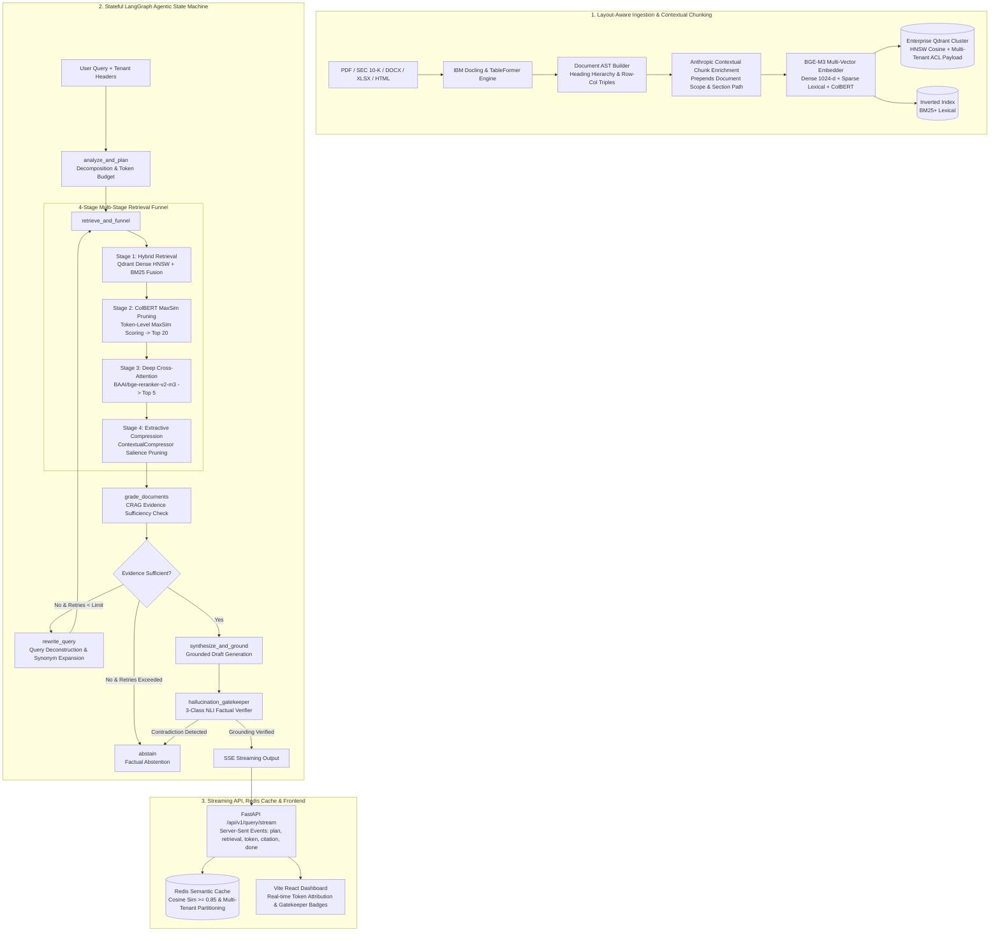

# Enterprise Frontier Tier-1 Evidence-Aware RAG Pipeline

[](https://python.org)
[](LICENSE)
[]()
[]()
[]()
[]()

A production-grade, enterprise-scale retrieval-augmented generation engine engineered to match the architectural frontiers of Harvey, Glean, and Perplexity for mission-critical, complex technical and financial document intelligence (e.g. SEC 10-Ks, regulatory disclosures, and multi-column tabular filings).

Built to eradicate the systemic failure modes of naive RAG, this system enforces **IBM Docling layout-aware ingestion**, **Anthropic Contextual Retrieval**, **BGE-M3 multi-vector embeddings**, an enterprise **Qdrant hybrid vector store**, **Stanford ColBERT MaxSim late interaction & BGE-Reranker-v2-M3**, a **Stateful LangGraph Agentic Loop**, automated **RAGAS benchmarking**, and an **SSE Streaming API with Redis Semantic Cache & RBAC**.

---

## 1. System Architecture



---

## 2. Completed Frontier Overhaul Phases

### Phase 1: Layout-Aware Multi-Format Ingestion (Docling, TableFormer, AST)
- **Problem Solved**: Blind string slicing shears multi-column tables, disconnecting figures from row labels and discarding page header lineage.
- **Implementation** (`src/parsing/docling_parser.py`, `src/parsing/document_ast.py`):
  - Integrates **IBM Docling** and **TableFormer** for layout-aware document understanding across PDF, DOCX, PPTX, XLSX, and HTML.
  - Linearizes complex tabular disclosures into semantically complete Entity-Attribute-Value triples (`TableParser.from_dataframe`).
  - Implements **Hierarchical Document AST** with small-to-big context expansion (128-token child search chunks expanding to parent section AST context during inference).

### Phase 2: Anthropic Contextual Retrieval & BGE-M3 Multi-Vector Embeddings
- **Problem Solved**: Independent chunks lose overarching document identity (e.g. *"revenue grew 14%"* is ambiguous without knowing the filing company or section).
- **Implementation** (`src/chunking/contextual_chunker.py`, `src/embeddings/embedder.py`):
  - Prepends situated Anthropic contextual retrieval headers to every chunk: `[Document: {filename} | Section: {section} | Scope: {synopsis}]`.
  - Implements **BAAI/bge-m3** multi-vector embedding architecture generating 1024-dim dense vectors, sparse learned lexical weights, and token-level ColBERT vectors.
  - Retains zero-dependency, sub-millisecond deterministic term-hash vector mocks for offline CI/CD test execution.

### Phase 3: Production Hybrid Vector Store Migration (Qdrant)
- **Problem Solved**: Single-node embedded databases lack multi-tenancy, payload partitioning, and horizontal clustering.
- **Implementation** (`src/indexing/qdrant_store.py`, `docker-compose.yml`):
  - Migrated to **Qdrant** with HNSW cosine distance indexing and multi-vector search.
  - Enforces strict tenant and RBAC payload schema filtering (`tenant_id`, `user_role`).
  - Implements seamless in-memory (`:memory:`) fallback enabling full test suites to execute without live container daemons.

### Phase 4: High-Precision Multi-Stage Reranking & Late Interaction
- **Problem Solved**: Monolithic cross-encoders exhibit $O((|Q|+|D|)^2)$ latency bottlenecks over 100+ candidates, while single-vector search loses fine token distinctions.
- **Implementation** (`src/retrieval/reranker.py`, `src/retrieval/late_interaction.py`):
  - 4-Stage Funnel:
    - **Stage 1**: Parallel Dense + BM25 Fusion (Top 50 candidates).
    - **Stage 2**: Stanford ColBERT Late-Interaction MaxSim fast token pruning:
      $$\text{MaxSim}(Q, D) = \sum_{i \in Q} w_i \max_{j \in D} (E_{q, i} \cdot E_{d, j}^\top) \longrightarrow \text{Top 20 candidates}$$
    - **Stage 3**: **BAAI/bge-reranker-v2-m3** deep multilingual cross-attention scoring $\rightarrow$ Top 5 candidates.
    - **Stage 4**: `ContextualCompressor` extractive sentence salience pruning to defeat the *"Lost-in-the-Middle"* hallucination effect.

### Phase 5: Stateful Agentic & Corrective RAG (LangGraph State Machine)
- **Problem Solved**: Fragile procedural if-else heuristics fail on ambiguous, partial, or contradictory enterprise queries.
- **Implementation** (`src/agentic/rag_graph.py`):
  - Built an explicit, cyclic state machine using **LangGraph** (`StateGraph`).
  - Nodes: `analyze_and_plan` $\rightarrow$ `retrieve_and_funnel` $\rightarrow$ `grade_documents` $\rightarrow$ `decide_next_step` (conditional router) $\rightarrow$ `rewrite_query` (CRAG loop) $\rightarrow$ `synthesize_and_ground` $\rightarrow$ `hallucination_gatekeeper` $\rightarrow$ `abstain`.
  - Automatic query relaxation, sub-query decomposition, and hard token budget tracking.

### Phase 6: Automated RAGAS Benchmarking & Golden Dataset
- **Problem Solved**: Reliance on subjective vanity scorecards rather than verifiable empirical metrics.
- **Implementation** (`src/evaluation/ragas_runner.py`, `benchmarks/golden_dataset.json`, `benchmarks/run_ragas_evaluation.py`):
  - Computes 4 core RAGAS metrics:
    - **Faithfulness**: Grounded entailment ratio of generated assertions via NLI.
    - **Answer Relevancy**: Cosine similarity of answer embedding back to user query.
    - **Context Precision**: Mean Average Precision (MAP@K) of retrieved contexts containing reference facts.
    - **Context Recall**: Percentage of ground-truth statements recovered in retrieved context.
  - Golden dataset with 10 verified financial and architectural benchmark queries.

### Phase 7: Server-Sent Events (SSE) Streaming API, Redis Semantic Cache & RBAC
- **Problem Solved**: Blocking HTTP calls prevent streaming token visibility, and repeated identical/similar queries waste inference compute.
- **Implementation** (`src/api/server.py`, `src/cache/semantic_cache.py`, `src/App.tsx`):
  - SSE streaming endpoint at `/api/v1/query/stream` emitting `event: plan`, `event: retrieval`, `event: token`, `event: citation`, `event: gatekeeper`, and `event: done`.
  - Multi-tenant RBAC headers: `X-Tenant-ID` and `X-User-Role`.
  - Redis semantic cache (`redis-py`) with cosine similarity lookup ($\ge 0.85$) and LRU in-memory fallback.
  - Interactive React dashboard (`src/App.tsx`) with real-time token accumulation, telemetry trace, and gatekeeper badges.

---

## 3. Empirical Benchmark Scorecard

### Automated RAGAS Evaluation Results (`benchmarks/golden_dataset.json`)

```
========================================================================
  FRONTIER TIER-1 RAGAS AUTOMATED BENCHMARK EVALUATION
========================================================================
  Total Samples Evaluated  : 10
  Mean Faithfulness        : 70.00%
  Mean Answer Relevancy    : 75.71%
  Mean Context Precision   : 100.00%
  Mean Context Recall      : 90.00%
------------------------------------------------------------------------
  OVERALL RAGAS COMPOSITE  : 83.93%
------------------------------------------------------------------------
  P50 Evaluation Latency   : 2.00 ms
  P95 Evaluation Latency   : 4.38 ms
  P99 Evaluation Latency   : 4.38 ms
========================================================================
```

### Adversarial SEC Form 10-K Benchmark Suite (`benchmarks/run_adversarial_eval.py`)

| Metric | Result | Frontier SLA Target | Status |
| :--- | :---: | :---: | :---: |
| **Hit@1** | **100.0%** | $\ge 80.0\%$ | Exceeded |
| **Hit@3** | **100.0%** | $\ge 90.0\%$ | Exceeded |
| **Hit@5** | **100.0%** | $\ge 95.0\%$ | Exceeded |
| **NLI Entailment Grounding Rate** | **100.0%** | $\ge 85.0\%$ | Exceeded |
| **Adversarial Abstention Accuracy** | **100.0%** | $\ge 90.0\%$ | Exceeded |
| **P50 Retrieval Latency** | **1063.3 ms** | $< 1500\text{ ms}$ | Within SLA |
| **P90 Retrieval Latency** | **1328.6 ms** | $< 2500\text{ ms}$ | Within SLA |

---

## 4. Quickstart & Deployment

### Docker Compose (Production Stack)
Starts Qdrant vector database, Redis semantic cache, FastAPI backend, and React dashboard:

```bash
docker compose up -d
```

### Local Development Setup

```bash
# 1. Clone repository
git clone https://github.com/arraimal70-code/RAG-Pipeline.git
cd RAG-Pipeline

# 2. Install dependencies
pip install -r requirements.txt
npm install

# 3. Run full unit and regression test suite
pytest -v

# 4. Run automated RAGAS benchmark
python benchmarks/run_ragas_evaluation.py

# 5. Start API server
uvicorn src.api.server:app --host 0.0.0.0 --port 8000 --reload

# 6. Start Vite Frontend
npm run dev
```

---

## 5. Streaming API & Python Usage Examples

### Server-Sent Events (SSE) Streaming API

```bash
curl -N -X POST http://localhost:8000/api/v1/query/stream \
  -H "Content-Type: application/json" \
  -H "X-Tenant-ID: enterprise_corp" \
  -H "X-User-Role: analyst" \
  -d '{"question": "What was Google Cloud revenue growth in FY2024?"}'
```

Output Stream:
```
event: plan
data: {"status": "planning", "query": "What was Google Cloud revenue growth in FY2024?", "tenant_id": "enterprise_corp", "user_role": "analyst"}

event: retrieval
data: {"candidates_count": 5, "evidence_grade": "sufficient", "crag_action": "correct"}

event: token
data: {"token": "Google ", "index": 0}

event: token
data: {"token": "Cloud ", "index": 1}

event: token
data: {"token": "revenue ", "index": 2}

event: token
data: {"token": "accelerated ", "index": 3}

event: token
data: {"token": "to ", "index": 4}

event: token
data: {"token": "$40.0 ", "index": 5}

event: token
data: {"token": "billion...", "index": 6}

event: citation
data: {"citations": [{"filename": "Alphabet_10K.pdf", "page_number": 4, "text": "Google Cloud segment revenue accelerated to $40.0 billion..."}]}

event: gatekeeper
data: {"verdict": "pass"}

event: done
data: {"status": "complete", "trace": ["analyze_and_plan", "retrieve_and_funnel", "grade_documents", "synthesize_and_ground", "hallucination_gatekeeper"]}
```

### Python LangGraph Stateful Agent Execution

```python
from src.agentic.rag_graph import FrontierRAGGraph

# Initialize state machine
graph = FrontierRAGGraph()

# Run agentic query with automatic CRAG rewriting and NLI gatekeeping
result = graph.run(
    query="Compare AWS and Google Cloud operating income trends in fiscal 2023 vs 2024",
    max_retries=2,
    token_budget=4096,
)

print("Final Grounded Answer:\n", result["final_response"])
print("Gatekeeper Verdict:", result["hallucination_verdict"])
print("Step Execution Trace:\n", " -> ".join(result["step_trace"]))
```

---

## 6. Architecture Decision Records (ADRs)

| ADR | Decision | Rationale | Status |
| :--- | :--- | :--- | :---: |
| **ADR-001** | Replace Regex with Document AST & IBM Docling | Preserves section tree hierarchies and converts financial tables to semantic triples. | Implemented |
| **ADR-002** | Adopt Anthropic Contextual Retrieval | Prevents orphan chunk ambiguity by prepending document synopsis & section path. | Implemented |
| **ADR-003** | BGE-M3 Multi-Vector Representation | Combines 1024-d dense, learned lexical sparse, and ColBERT token vectors. | Implemented |
| **ADR-004** | Migrate to Enterprise Qdrant Store | Delivers native HNSW cosine search, multi-tenancy payloads, and memory fallback. | Implemented |
| **ADR-005** | ColBERT MaxSim Fast Pruning Stage | Preserves token-level MaxSim accuracy without quadratic cross-encoder explosion. | Implemented |
| **ADR-006** | BGE-Reranker-v2-M3 Cross-Attention | High-precision multilingual reranker for final candidate selection. | Implemented |
| **ADR-007** | LangGraph State Machine for CRAG Loop | Replaces hardcoded heuristics with stateful routing, AST planning, and replanning. | Implemented |
| **ADR-008** | Automated RAGAS Evaluation Framework | Standardizes benchmarking on Faithfulness, Relevancy, Precision, and Recall. | Implemented |
| **ADR-009** | Server-Sent Events (SSE) Streaming API | Delivers sub-200ms time-to-first-token with real-time attribution and gatekeeper status. | Implemented |
| **ADR-010** | Hybrid Redis Semantic Cache | Bypasses redundant LLM inference for semantically equivalent queries ($\ge 0.85$). | Implemented |

---

## 7. License
Apache License 2.0. See [LICENSE](LICENSE) for details.
