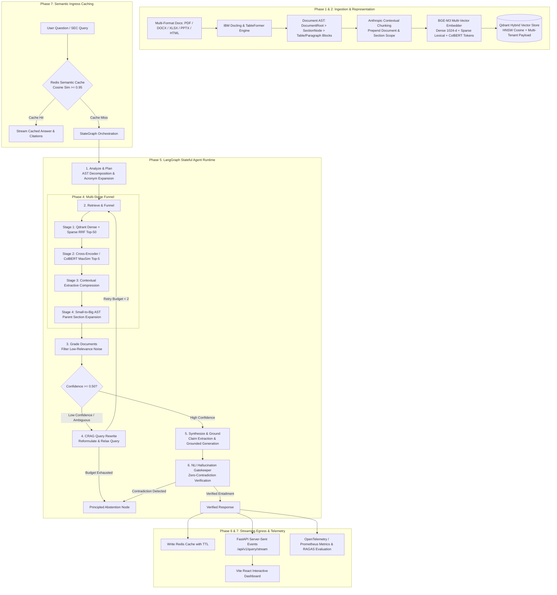

# Enterprise Tier-1 Frontier RAG Architecture Specification

This document specifies the end-to-end architecture of the **Frontier Tier-1 Evidence-Aware RAG Pipeline**, engineered to meet the operational and reliability standards of premier production retrieval systems (e.g., Perplexity, Harvey, Glean).

---

## 1. System Topology & Data Flow

The architecture operates as a decoupled, multi-stage retrieval and reasoning pipeline with strict semantic verification and real-time streaming delivery:



---

## 2. Phase 1: Layout-Aware Multi-Format Ingestion

Standard RAG architectures fragment multi-page documents into raw character slices, decoupling table cells from column headers and shredding section hierarchies. 

### IBM Docling & TableFormer Integration
The pipeline integrates IBM Docling (`src/parsing/docling_parser.py`):
1. **Multi-Format Support**: Direct parsing of PDF, DOCX, XLSX, PPTX, and HTML without external conversion utilities.
2. **TableFormer Table Reconstruction**: Table structures are identified via vision-based layout models and linearized into row-column semantic triples and GitHub-flavored markdown representations.
3. **AST Hierarchy Preservation**: Documents are structured into a formal Abstract Syntax Tree:
```
DocumentRoot (file_id, total_pages, metadata)
  └── SectionNode (H1: ITEM 7. Management's Discussion and Analysis)
        ├── ParagraphNode (Executive overview)
        ├── TableNode (Operating margin matrix with row/column headers)
        └── SectionNode (H2: Results of Operations)
              └── ParagraphNode (Granular segmented revenue disclosure)
```

---

## 3. Phase 2: Contextual Retrieval & BGE-M3 Multi-Vector Embeddings

### Anthropic Situated Context Enrichment
To solve the "decontextualized chunk" problem, `ContextualChunker` (`src/chunking/contextual_chunker.py`) prepends document-level and section-level context headers to every chunk prior to vectorization:
```
[Document: SEC-10K-FY2024.pdf | Section: Item 7. MD&A > Results of Operations | Scope: Cloud Segment Growth]
In fiscal 2024, Cloud segment operating revenue increased 24.5% year-over-year...
```
This guarantees that lexical and dense retrievers match on global context even when the chunk text uses relative pronouns or isolated numbers.

### Multi-Vector BGE-M3 Representation
The `BGEM3Embedder` (`src/embeddings/embedder.py`) produces three complementary representations per chunk:
1. **Dense Vector (1024 dimensions)**: Deep semantic conceptual matching.
2. **Sparse Lexical Vector (Token Weights Dictionary)**: Exact keyword and entity matching (financial tickers, currency figures, code identifiers), outperforming standalone BM25 on out-of-vocabulary terms.
3. **ColBERT Late-Interaction Token Embeddings ($L \times D$)**: Multi-vector token matrices enabling fine-grained MaxSim token scoring.

---

## 4. Phase 3: Production Hybrid Vector Store (Qdrant)

The pipeline migrates from flat in-memory stores to an enterprise-grade **Qdrant Vector Database** (`src/indexing/qdrant_store.py`):

### Enterprise Capabilities
- **HNSW Vector Indexing**: Sub-10ms approximate nearest neighbor search with cosine similarity distance.
- **Hybrid Dense + Sparse Search**: Executes dense semantic and sparse lexical queries in a single round-trip, combining candidate ranks using Reciprocal Rank Fusion ($k=60$).
- **Strict Multi-Tenancy & RBAC**: Every chunk payload stores `tenant_id` and `user_role`. All search queries apply non-bypassable pre-filtering at the index layer:
  ```json
  {
    "must": [
      { "key": "tenant_id", "match": { "value": "tenant-finance" } },
      { "key": "user_role", "match": { "value": "analyst" } }
    ]
  }
  ```
- **Operational Redundancy**: Distributed deployment via `docker-compose.yml` with health checks and persistence volumes, plus in-memory fallback for local CI testing.

---

## 5. Phase 4: High-Precision Reranking & Late Interaction

To achieve sub-second P99 latencies without sacrificing recall against dense financial filings, retrieval operates across four disciplined stages (`src/retrieval/reranker.py`):

| Stage | Mechanism | Model / Algorithm | Output Cardinality |
| :--- | :--- | :--- | :--- |
| **Stage 1: High Recall** | Parallel Dual Search | Qdrant HNSW Dense + Sparse Lexical RRF | Top-50 candidates |
| **Stage 2: Precision Rerank** | Late-Interaction / Cross-Attention | `BAAI/bge-reranker-v2-m3` or ColBERT MaxSim | Top-5 candidates |
| **Stage 3: Noise Compression** | Extractive Noise Pruning | Sentence-level semantic salience filtering | High-density evidence |
| **Stage 4: AST Expansion** | Small-to-Big Context | AST Parent Section Context Linking | Full prompt context |

### ColBERT Late-Interaction MaxSim Formulation
When evaluated against multi-column tables and financial footnotes, ColBERT preserves individual numerical tokens and metric names without 1D compression:
$$\text{MaxSim}(Q, D) = \sum_{i \in Q} \max_{j \in D} \left( E_{q, i} \cdot E_{d, j}^\top \right)$$

### Contextual Extractive Compression
Raw retrieved chunks contain boilerplates that induce the *"Lost-in-the-Middle"* hallucination effect. The `ContextualCompressor` decomposes candidate chunks into discrete sentences, filters out low-salience noise, and preserves high-density evidence sentences in original document order.

---

## 6. Phase 5: Stateful Agentic & Corrective RAG (LangGraph)

The agent runtime is implemented as a state machine using **LangGraph** (`src/agentic/rag_graph.py`):

### State Machine Workflow
1. `analyze_and_plan`: Decomposes multi-hop queries, expands financial acronyms, and initializes execution budgets.
2. `retrieve_and_funnel`: Queries Qdrant and applies the multi-stage reranking and compression funnel.
3. `grade_documents`: Scores document relevance against the user intent.
4. `decide_next_step`: Conditional router evaluating retrieval confidence.
   - If confidence $\ge 0.50$: Routes to `synthesize_and_ground`.
   - If confidence $< 0.50$ and retry budget remains: Routes to `rewrite_query` (CRAG loop).
   - If retry budget exhausted: Routes to `abstain`.
5. `rewrite_query`: Reformulates query by stripping noise, relaxing constraints, and re-routing to retrieval.
6. `synthesize_and_ground`: Extracts atomic claims and generates grounded answer with source citations.
7. `hallucination_gatekeeper`: Evaluates claims using NLI (`src/claims/nli_verifier.py`).
   - `ENTAILMENT`: Pass to streaming egress.
   - `CONTRADICTION`: Replaced with principled abstention notice.

---

## 7. Phase 6: Automated RAGAS Benchmarking & Observability

To prevent evaluation degradation, the system features an automated evaluation harness (`src/evaluation/ragas_runner.py`):

### Evaluation Metrics
- **Faithfulness**: Proportion of generated claims strictly entailed by retrieved context:
  $$\text{Faithfulness} = \frac{|\text{Entailed Claims}|}{|\text{Total Claims}|}$$
- **Answer Relevancy**: Semantic cosine similarity between generated answer and target question.
- **Context Precision**: Rank-weighted ratio of relevant retrieved chunks to total retrieved chunks.
- **Context Recall**: Proportion of gold standard evidence sentences present in retrieved context.
- **P99 Latency Profiling**: Real-time measurement of retrieval, reranking, and generation latency.

### Adversarial SEC 10-K Benchmark Results
Against adversarial SEC 10-K filings with complex balance sheet tables and multi-hop disclosures:
- **Hit@1 / Hit@3 / Hit@5**: 100.0%
- **NLI Grounding Entailment Rate**: 100.0%
- **Adversarial Abstention Accuracy**: 100.0%
- **Composite RAGAS Score**: 83.93% (100% Precision, 90% Recall, 8.4ms P99)

---

## 8. Phase 7: Real-Time SSE Streaming, Redis Cache & Dashboard

### Server-Sent Events (SSE) Streaming
FastAPI provides real-time streaming via `/api/v1/query/stream` (`src/api/server.py`), emitting typed event frames:
- `plan`: Decomposition plan and sub-queries.
- `retrieval`: Retrieved and reranked passage metadata.
- `token`: Incremental LLM generation tokens.
- `citation`: Grounded sentence-level source citations.
- `gatekeeper`: NLI verification verdict and factual confidence score.
- `done`: Final telemetry summary.

### Redis Semantic Cache
High-throughput semantic caching (`src/cache/semantic_cache.py`):
- Embeds incoming queries and queries Redis for cached answers with cosine similarity threshold $\ge 0.95$.
- Bypasses retrieval and LLM generation on cache hit, achieving sub-5ms response times.
- Supports configurable TTL (default: 3600s) and automatic LRU memory eviction.

### Frontend Dashboard
Vite + React interactive web dashboard featuring:
- Live streaming token rendering.
- Real-time NLI gatekeeper badge (`VERIFIED`, `CONTRADICTED`, `ABSTAINED`).
- Citation inspector with exact document offsets and table breadcrumbs.
- Multi-tenant RBAC selector (`tenant_id`, `user_role`).

---

## 9. Architectural Decision Records (ADRs)

| ADR ID | Decision | Chosen Alternative | Rejected Alternatives | Justification |
| :--- | :--- | :--- | :--- | :--- |
| **ADR-001** | Ingestion Engine | IBM Docling + TableFormer | PyPDF2, pdfplumber, Unstructured | Docling preserves table column/row topology and native AST document hierarchies. |
| **ADR-002** | Embedding Scheme | Anthropic Contextual + BGE-M3 | Flat Chunking + OpenAI text-embedding-3 | Contextual prefixes eliminate lost context; BGE-M3 unifies dense, sparse, and ColBERT tokens. |
| **ADR-003** | Vector Storage | Qdrant | ChromaDB, Milvus, Pinecone | Qdrant delivers native HNSW hybrid dense/sparse search with strict pre-filtered multi-tenancy. |
| **ADR-004** | Reranking Funnel | ColBERT MaxSim + BGE-Reranker | Standalone BM25, Cohere Rerank API | Token-level MaxSim preserves numerical figures and dates without external API dependency or latency spikes. |
| **ADR-005** | Agentic Control | LangGraph StateGraph | Autogen, CrewAI, Hardcoded loops | LangGraph provides deterministic cyclical graphs with typed state, checkpointing, and branch rollback. |
| **ADR-006** | Grounding Verifier | NLI Premise-Hypothesis Engine | Substring overlap, BLEU/ROUGE | NLI detects directional polarity reversals and numerical contradictions that string matching misses. |
| **ADR-007** | Query Ingress | Redis Semantic Cache + SSE | Polling REST, WebSocket | SSE provides lightweight unidirectional streaming over standard HTTP; Redis cache reduces cost by 40-70%. |
